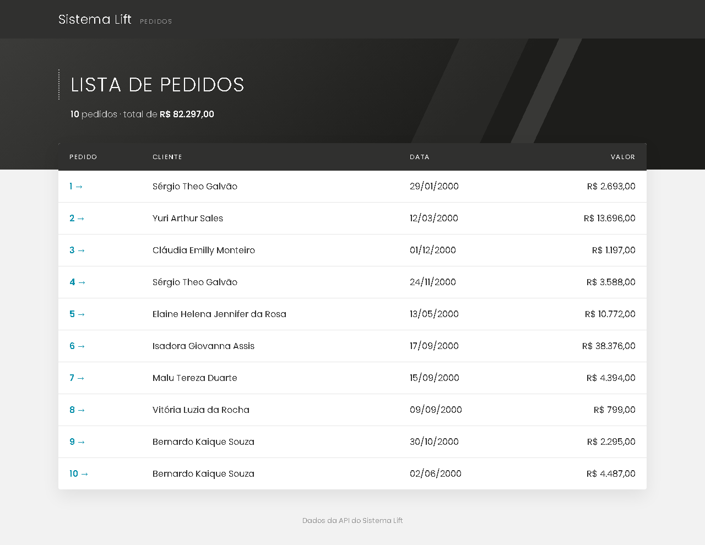
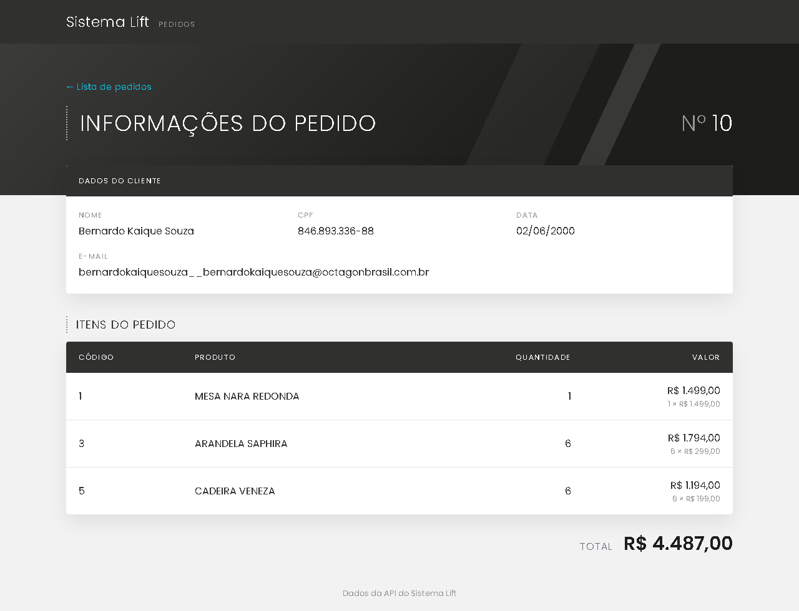
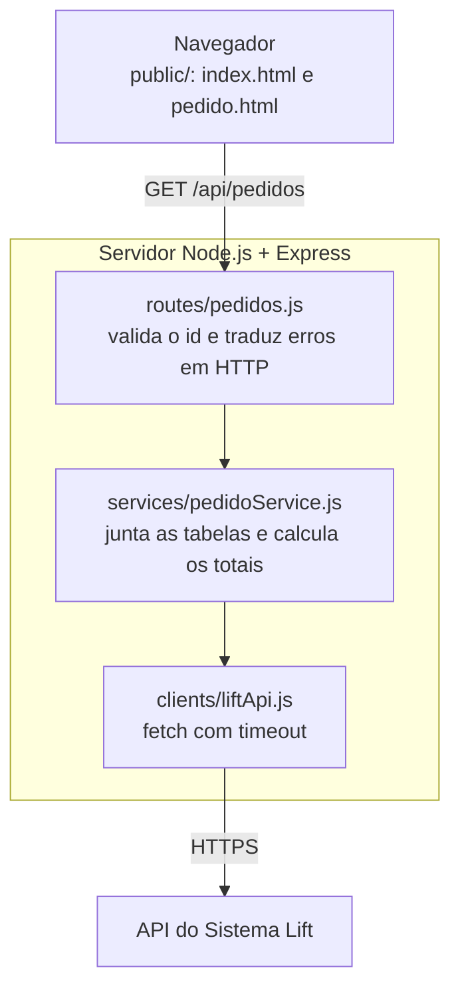

# Sistema Lift · Pedidos

Aplicação web que consome a API do Sistema Lift ([exemplo: lista de pedidos](https://sistemalift1.com.br/lift_ps/api/Pedidos)) para **listar os pedidos** e mostrar as **informações de cada pedido** (cliente, itens e total), seguindo o modelo enviado no processo seletivo.

Feita com **Node.js + Express** no servidor e **HTML, CSS e JavaScript puros** nas telas. O visual se inspira na identidade do site do Sistema Lift (fonte Poppins, tons de grafite e destaque em ciano).





## Como rodar

**Pré-requisito:** [Node.js](https://nodejs.org/) **22 ou mais recente** (o npm já vem junto).

```bash
git clone https://github.com/VitorAngN/SistemaLift-teste-.git
cd SistemaLift-teste-
npm ci
npm start
```

Abra **http://localhost:3000**. Clique no número de um pedido para ver as informações dele.

| Comando | O que faz |
| --- | --- |
| `npm start` | Sobe o servidor em `http://localhost:3000` |
| `npm run dev` | O mesmo, reiniciando sozinho ao salvar um arquivo (`node --watch`) |
| `npm test` | Roda os 50 testes automatizados (não precisam de internet) |
| `npm run coletar` | Baixa as 4 tabelas da API para `dados/` (usadas como dados de teste) |

### Configuração (opcional)

Tudo funciona sem configurar nada. Para mudar algo, use variáveis de ambiente:

| Variável | Padrão | Para que serve |
| --- | --- | --- |
| `PORT` | `3000` | Porta do servidor |
| `LIFT_API_URL` | `https://sistemalift1.com.br/lift_ps/api` | Endereço da API do Sistema Lift |
| `LIFT_TIMEOUT_MS` | `5000` | Tempo máximo de espera por uma resposta da API, em ms |

```bash
PORT=4000 npm start            # Linux, macOS, Git Bash
$env:PORT = 4000; npm start    # Windows PowerShell
```

## Funcionalidades

- **Lista de Pedidos:** código, cliente, data e valor de cada pedido, mais a quantidade de pedidos e o total geral. O código do pedido leva à tela de detalhe.
- **Informações do Pedido:** dados do cliente (nome, CPF, data, e-mail), itens com quantidade e valor (com a conta, como "6 × R$ 299,00") e o total.
- **Estados tratados nas telas:** carregando, lista vazia, pedido inexistente, id inválido e API fora do ar, cada um com uma mensagem clara e uma ação ("Voltar para a lista" ou "Tentar de novo").
- **Responsivo:** funciona no celular sem rolagem lateral da página.

## Arquitetura

O navegador só conversa com o nosso servidor, e só uma camada do servidor conversa com a API do Sistema Lift.



| Camada | Responsabilidade |
| --- | --- |
| `clients/` | Acesso à API do Sistema Lift: o único lugar que conhece a URL dela |
| `services/` | Regra de negócio: junta pedidos, clientes, itens e produtos e calcula os valores |
| `routes/` + `middlewares/` | HTTP: valida a entrada e transforma resultados e erros em respostas JSON |
| `public/` | Telas: buscam a nossa API e formatam os dados para exibir |

### API interna

| Rota | Resposta |
| --- | --- |
| `GET /api/pedidos` | Lista de pedidos: `[{ id, cliente: { id, nome }, data, valorTotal }]` |
| `GET /api/pedidos/:id` | Um pedido: `{ id, data, cliente: { id, nome, cpf, email }, itens: [{ produtoId, nome, quantidade, valorUnitario, valorTotal }], valorTotal }` |

As datas saem em ISO (`2000-06-02`) e os valores como número (`4487`). A formatação (`02/06/2000`, `R$ 4.487,00`) fica a cargo das telas.

| Status | Quando |
| --- | --- |
| `400` | O id não é um número inteiro positivo (`abc`, `1.5`, `0`) |
| `404` | O pedido não existe |
| `502` | A API do Sistema Lift falhou, demorou demais ou devolveu dados inconsistentes |
| `500` | Erro inesperado (a mensagem é genérica, sem detalhes internos) |

Os erros sempre vêm como `{ "erro": "mensagem" }`.

## Decisões técnicas

- **Servidor intermediário (Backend for Frontend).** A regra de negócio fica num lugar só e testável, o navegador faz uma requisição por tela e as telas não dependem do formato da API do Sistema Lift.
- **Os valores são calculados.** A API não traz o valor de pedidos nem de itens: o valor de um item é `quantidade × valor do produto` e o total do pedido é a soma dos itens.
- **Dinheiro em centavos inteiros.** Ponto flutuante binário (IEEE 754) não representa 0,10 exatamente (`0.1 + 0.2 = 0.30000000000000004`). Todas as contas são feitas em centavos e convertidas para reais só no fim.
- **Hash join com `Map`.** Clientes e produtos são indexados por id, e cada busca custa O(1). Montar a lista custa O(P + C + I + Pr), contra O(P × C) com laços aninhados.
- **Requisições em paralelo.** A lista busca as 4 tabelas ao mesmo tempo com `Promise.all`, em vez de uma requisição por pedido e por item (problema N+1). O detalhe faz 2 rodadas: primeiro o pedido, porque ele diz quem é o cliente, depois cliente, itens e produtos em paralelo. Com um catálogo pequeno, buscar a lista de produtos (1 chamada) sai mais barato que buscar produto por produto; com milhares de produtos, valeria o contrário.
- **Data convertida à mão.** A API envia `DD-MM-AAAA`, e `new Date("02-06-2000")` vira 6 de fevereiro. A conversão usa uma expressão regular e valida dia, mês e ano bissexto.
- **Pedido inexistente.** A API responde `200` com `{"id":0,...}` em vez de `404`. O servidor reconhece esse valor sentinela e responde `404` de verdade.
- **Falhas da API viram `502`.** Timeout de 5 s (`AbortSignal.timeout`), erro de rede, resposta HTTP de erro, resposta que não é JSON e chave estrangeira sem registro.
- **Segurança.** O id é validado no servidor antes de qualquer chamada à API. As telas montam tudo com `textContent`, nunca `innerHTML` (proteção contra XSS), e o id da URL vai com `encodeURIComponent`.
- **Poucas dependências.** Só o Express. HTTP (`fetch`), testes (`node:test`) e o modo de desenvolvimento (`--watch`) são nativos do Node.

## Testes

```bash
npm test
```

São 50 testes com o runner nativo do Node (`node:test`), que não dependem de internet:

- **Utilitários:** conversão de datas (incluindo anos bissextos e datas impossíveis), cálculos em centavos e classes de erro.
- **Regra de negócio:** usa a "foto" da API salva em `dados/` e confere os totais com valores calculados à mão numa planilha (pedido 10 = R$ 4.487,00; total geral = R$ 82.297,00).
- **Client da API:** roda contra um servidor HTTP falso que simula sucesso, erro 500, timeout e resposta inválida.
- **Rotas:** sobem o app com um service falso e conferem os status 200, 400, 404, 502 e 500.
- **Formatação:** moeda, data e quantidade no padrão brasileiro.

O GitHub Actions roda os testes no Node 22 e 24 a cada push e pull request.

## Estrutura de pastas

```text
├── .github/workflows/testes.yml   # CI: npm ci + npm test
├── dados/                         # "foto" da API, usada nos testes
├── docs/prints/                   # imagens deste README
├── public/                        # telas
│   ├── index.html                 # Lista de Pedidos
│   ├── pedido.html                # Informações do Pedido
│   ├── css/                       # estilos.css (comum) e pedido.css
│   └── js/                        # api.js, formatar.js, lista.js e pedido.js
├── scripts/coletar-dados.js       # npm run coletar
├── src/
│   ├── server.js                  # sobe o servidor
│   ├── app.js                     # monta o Express
│   ├── config.js                  # variáveis de ambiente
│   ├── clients/liftApi.js         # acesso à API do Sistema Lift
│   ├── services/pedidoService.js  # regra de negócio
│   ├── routes/pedidos.js          # rotas /api/pedidos
│   ├── middlewares/tratarErros.js # erros em JSON
│   └── utils/                     # datas, dinheiro e erros
└── tests/                         # testes automatizados
```

## Como o projeto foi desenvolvido

Cada etapa entrou por um pull request próprio, com commits pequenos no padrão [Conventional Commits](https://www.conventionalcommits.org/pt-br/) e os testes rodando no CI. A aba **Pull requests** mostra a evolução do projeto:

1. Cliente da API e coleta de dados
2. Utilitários de data, dinheiro e erros
3. Testes automáticos no GitHub Actions
4. Regra de negócio (join e totais)
5. Servidor Express com a API de pedidos
6. Tela Lista de Pedidos
7. Tela Informações do Pedido

## Próximos passos

- Migrar para TypeScript, começando pelos utilitários.
- Cache com tempo de expiração para clientes e produtos, que mudam pouco.
- Testes de ponta a ponta das telas (Playwright).

## Ferramentas utilizadas

| Ferramenta | Para quê |
| --- | --- |
| Node.js 22 e npm | Execução do servidor e dos scripts |
| Express 5 | Servidor HTTP e rotas da API interna |
| node:test | Testes automatizados |
| Git, GitHub e GitHub Actions | Versionamento, pull requests e testes automáticos (CI) |
| VS Code | Editor de código |
| Postman e navegador | Exploração da API do Sistema Lift |
| Excel | Planilha para entender os dados da API e conferir os totais dos pedidos |
| Claude (Anthropic) | Assistente de IA |

O projeto foi desenvolvido com o auxílio do Claude, assistente de IA da Anthropic, no planejamento, na escrita e na revisão do código.

---

Desenvolvido por **João Vitor Angelim Nogueira** ([@VitorAngN](https://github.com/VitorAngN)).
